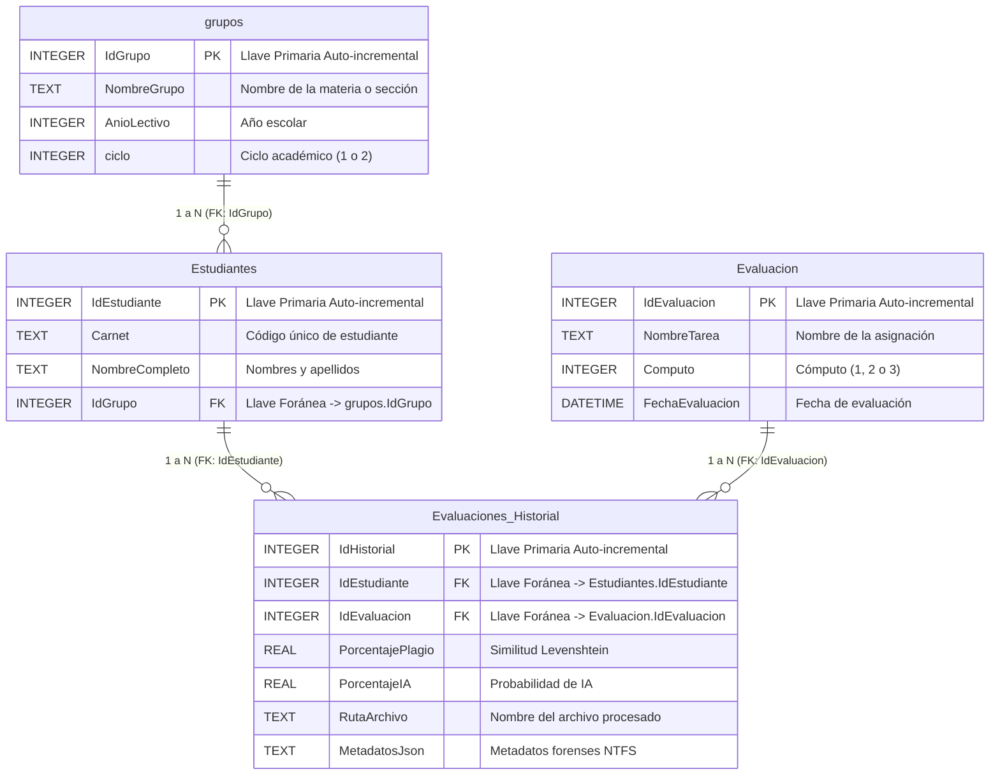

# DOCUMENTO DE AVANCE: BASE DE DATOS, FORMAS NORMALES Y FORMULARIOS CRUD CON VALIDACIÓN

---

## 1. LAS TRES FORMAS NORMALES (3FN)

El diseño de la base de datos relacional sobre **SQLite** (`sistema_plagio.db`) implementada mediante **Entity Framework Core 10** cumple estrictamente con las Tres Formas Normales de la teoría de bases de datos relacionales:

### 1.1 Primera Forma Normal (1FN)
* **Atomicidad:** Cada columna de cada tabla contiene exclusivamente valores atómicos e indivisibles (por ejemplo, `Carnet`, `NombreCompleto`, `AnioLectivo`, `Computo`).
* **Sin grupos repetitivos:** No existen listas de estudiantes empaquetadas en cadenas separadas por comas dentro de la tabla de grupos, ni historiales embebidos.
* **Claves primarias definidas:** Todas las tablas cuentan con una clave primaria explícita simple de tipo entero auto-incremental (`IdGrupo`, `IdEstudiante`, `IdEvaluacion`, `IdHistorial`).

### 1.2 Segunda Forma Normal (2FN)
* Se cumple 1FN.
* **Dependencia funcional completa:** Todos los atributos que no forman parte de la clave primaria dependen funcionalmente de manera completa de la clave primaria completa de la tabla. Al tener todas las tablas claves primarias simples (de una sola columna), no existe posibilidad de dependencias funcionales parciales.

### 1.3 Tercera Forma Normal (3FN)
* Se cumple 2FN.
* **Eliminación de dependencias transitivas:** Ningún atributo no clave depende de otro atributo no clave.
  - La información del grupo (`NombreGrupo`, `AnioLectivo`, `ciclo`) reside únicamente en la tabla `grupos`. La tabla `Estudiantes` no almacena el nombre ni el ciclo del grupo, sino únicamente la clave foránea `IdGrupo`.
  - La tabla `Evaluacion` almacena únicamente los datos propios de la tarea (`NombreTarea`, `Computo`, `FechaEvaluacion`).
  - La tabla `HistorialAnalisis` (`Evaluaciones`) no duplica datos personales del estudiante ni el nombre de la tarea; únicamente almacena los resultados específicos de la ejecución (`PorcentajePlagio`, `PorcentajeIA`, `RutaArchivo`, `MetadatosJson`) referenciando a `IdEstudiante` y a `IdEvaluacion`.

---

## 2. USO DE LLAVES PRIMARIAS Y LLAVES FORÁNEAS

La integridad referencial y de identidad está implementada tanto a nivel de clases modelo (`Data/Models/`) como en el mapeo relacional de `AppDbContext.cs`:

### Detalle de Llaves e Índices:
1. **Tabla `grupos`:**
   - **Llave Primaria (PK):** `IdGrupo` (`INTEGER PRIMARY KEY AUTOINCREMENT`).
2. **Tabla `Estudiantes`:**
   - **Llave Primaria (PK):** `IdEstudiante` (`INTEGER PRIMARY KEY AUTOINCREMENT`).
   - **Llave Foránea (FK):** `IdGrupo` que referencia a `grupos(IdGrupo)`.
   - **Índice Único Compuesto:** `IX_Estudiantes_Carnet_IdGrupo` para evitar duplicidad de carnets dentro de un mismo grupo.
3. **Tabla `Evaluacion`:**
   - **Llave Primaria (PK):** `IdEvaluacion` (`INTEGER PRIMARY KEY AUTOINCREMENT`).
4. **Tabla `Evaluaciones` (`HistorialAnalisis`):**
   - **Llave Primaria (PK):** `IdHistorial` (`INTEGER PRIMARY KEY AUTOINCREMENT`).
   - **Llaves Foráneas (FK):** `IdEstudiante` (hacia `Estudiantes`) e `IdEvaluacion` (hacia `Evaluacion`).
   - **Índices de búsqueda:** `IX_Evaluaciones_IdEstudiante` e `IX_Evaluaciones_IdEvaluacion`.

---

## 3. CREACIÓN DE LOS 3 FORMULARIOS BÁSICOS

Se implementaron tres formularios completos con interfaz gráfica reactiva en Blazor:

1. **Formulario 1: Gestión de Estudiantes (`/grupos` - Pestaña Estudiantes)**
   - Permite dar de alta a nuevos alumnos asignándolos a su respectiva cohorte y visualizar el padrón en una grilla interactiva.
2. **Formulario 2: Gestión de Grupos / Asignaturas (`/grupos` - Pestaña Grupos)**
   - Permite la creación y administración de grupos académicos con definición de Nombre, Año Lectivo y Ciclo.
3. **Formulario 3: Gestión de Evaluaciones Académicas (`/evaluaciones`)**
   - Permite registrar y gestionar las tareas o prácticas de laboratorio divididas por Cómputo (1, 2 o 3) y fecha.

---

## 4. CRUD COMPLETO 100% FUNCIONAL

Cada uno de los tres formularios implementa de forma completa las cuatro operaciones de persistencia relacional (**C**reate, **R**ead, **U**pdate, **D**elete):

| Formulario | Crear (Create) | Leer (Read) | Modificar (Update) | Eliminar (Delete) |
| :--- | :--- | :--- | :--- | :--- |
| **1. Estudiantes** | Modal interactivo para registrar nuevo alumno en SQLite. | Listado en tabla con badges de carnet, grupo y conteo de historiales. | Botón con lápiz (`bi-pencil-square`) que carga datos en modal para editar y guardar. | Botón basurero (`bi-trash`) que remueve el registro con confirmación. |
| **2. Grupos** | Modal para agregar nueva sección o materia. | Grilla con conteo en tiempo real de alumnos inscritos. | Edición en modal para cambiar nombre, año o ciclo lectivo. | Eliminación segura con validación de restricción (no permite borrar si tiene alumnos). |
| **3. Evaluaciones** | Modal para crear nuevas prácticas o asignaciones. | Tabla clasificada con badges de color según el cómputo (1, 2 o 3). | Edición en modal con actualización asíncrona de nombre, cómputo y fecha. | Eliminación física en base de datos mediante EF Core. |

---

## 5. BÚSQUEDA INTERACTIVA EN LOS 3 FORMULARIOS

Los tres formularios incorporan barras de búsqueda interactiva en tiempo real (`@bind:event="oninput"`) que filtran los registros instantáneamente mientras el usuario escribe, combinados con selectores reactivos:

1. **Búsqueda en Formulario de Estudiantes:**
   - Filtro instantáneo por coincidencia en **Carnet** o **Nombre Completo**.
   - Filtro combinado por **Grupo**, **Ciclo (1 o 2)** y **Año Lectivo**.
   - Botón para limpiar y restablecer filtros.
2. **Búsqueda en Formulario de Grupos:**
   - Búsqueda interactiva por **Nombre de Grupo / Asignatura**.
   - Filtro por **Ciclo (1 o 2)**.
   - Botón de limpieza rápida.
3. **Búsqueda en Formulario de Evaluaciones:**
   - Búsqueda en vivo por **Nombre de Asignación / Laboratorio**.
   - Filtro por **Cómputo (1, 2 o 3)** y por **Año de registro**.
   - Botón de restablecimiento.

---

## 6. VALIDACIÓN RIGUROSA DE LA INFORMACIÓN

Todos los formularios cuentan con validación de datos tanto del lado del cliente como a nivel lógico antes de persistir en SQLite, mostrando alertas visuales descriptivas e indicando con `is-invalid` los campos con errores:

1. **Validaciones en Formulario de Estudiantes:**
   - Carnet obligatorio y con longitud mínima de 4 caracteres.
   - Nombre completo obligatorio y con longitud mínima de 5 caracteres.
   - Selección obligatoria de un grupo existente.
   - **Validación anti-duplicados:** Verificación de unicidad en base de datos para impedir que se registre el mismo carnet dos veces en el mismo grupo.
2. **Validaciones en Formulario de Grupos:**
   - Nombre del grupo obligatorio con un mínimo de 3 caracteres.
   - Año lectivo restringido a un rango coherente (2000 a 2100).
   - Ciclo estrictamente validado a valores permitidos (1 o 2).
   - **Integridad referencial en borrado:** Bloqueo de eliminación si el grupo aún tiene alumnos inscritos.
3. **Validaciones en Formulario de Evaluaciones:**
   - Nombre de la tarea obligatorio con longitud mínima de 4 caracteres.
   - Cómputo validado en rango permitido (1, 2 o 3).
   - Fecha de evaluación válida obligatoria.
   - **Validación de no redundancia:** No permite registrar dos evaluaciones con el mismo nombre dentro del mismo cómputo.
