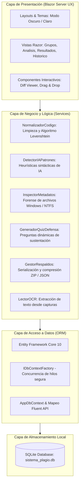
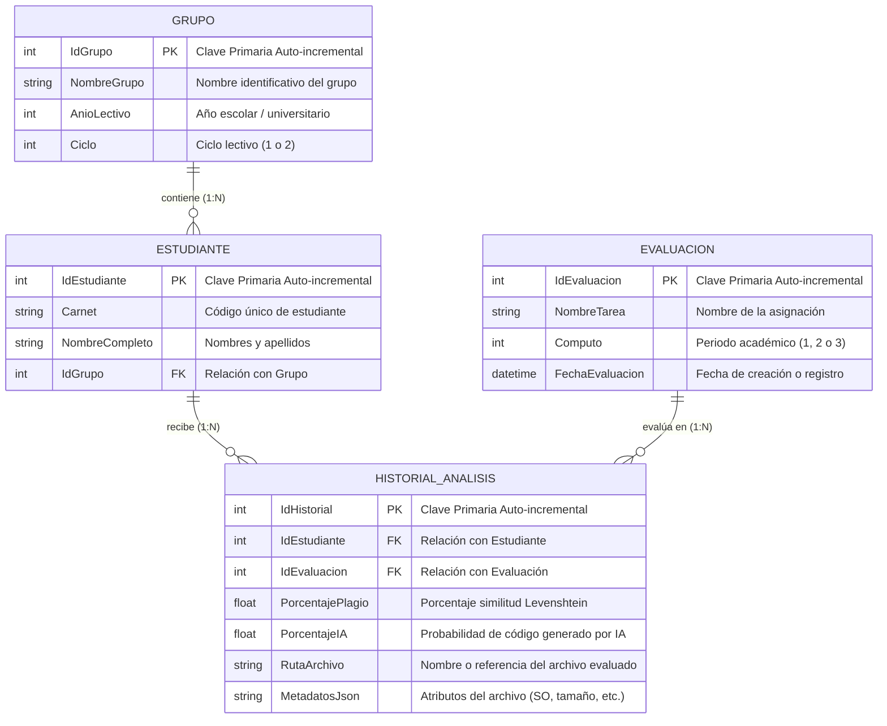

# DOCUMENTO DE PRIMER AVANCE DE PROYECTO

---

## 1. NOMBRE DEL PROYECTO
**PlagScan Pro - Sistema Web Local de Detección de Plagio y Análisis de Inteligencia Artificial para Código Fuente**

---

## 2. DESCRIPCIÓN DEL PROYECTO Y ALCANCE

### 2.1 ¿En qué consiste el proyecto?
El proyecto consiste en una aplicación web interactiva desarrollada bajo el enfoque **Local-First** (ejecución y almacenamiento 100% en la computadora local del docente o evaluador), orientada al análisis, auditoría y aseguramiento de la integridad académica en asignaciones de programación en lenguaje C#.

La aplicación permite centralizar la gestión de estudiantes por grupos de clase, procesar archivos de código fuente (`.cs`), comparar similitudes lógicas entre entregas de compañeros mediante algoritmos de distancia de edición (Levenshtein y n-gramas), detectar patrones característicos de código generado por modelos de Inteligencia Artificial (LLMs como ChatGPT o Copilot), inspeccionar atributos forenses del sistema operativo (metadatos NTFS) y generar cuestionarios personalizados de defensa oral para que el docente pueda interrogar al alumno sobre la autoría de su código.

### 2.2 Alcance del Proyecto

#### Alcance General:
1. **Módulo de Gestión Académica (Grupos y Alumnos):** Administración completa de grupos lectivos organizados por Ciclo (1 o 2) y Año, registro individual de alumnos, importación masiva mediante listas de texto plano o CSV, y exportación/importación completa de la cohorte en paquetes comprimidos `.zip` con formato JSON.
2. **Módulo de Carga y Pre-procesamiento de Código:** Carga mediante Drag & Drop de archivos de código `.cs` o capturas de imagen (OCR), saneamiento de rutas para evitar vulnerabilidades de *Path Traversal* y normalización del código (eliminación de espacios irrelevantes, comentarios y abstracción de cadenas de texto).
3. **Módulo de Análisis Comparativo y Modo a Ciegas (Blind Grading):** Comparación simultánea entre dos entregas, visor diferencial lado a lado (*Diff Viewer*) que resalta líneas idénticas, similares y únicas, y opción de anonimizar automáticamente carnets y nombres para evitar sesgos cognitivos durante la corrección.
4. **Módulo de Detección de Patrones de IA:** Motor heurístico de análisis estático que evalúa marcadores explicativos de IA, exceso de documentación XML (`/// <summary>`), nombres de variables canónicas y validaciones defensivas desproporcionadas.
5. **Módulo Forense e Inspector de Metadatos:** Lectura de propiedades del archivo en Windows (fechas reales de creación y modificación en disco, propietario del archivo en el sistema operativo, codificación de texto y presencia de BOM).
6. **Módulo de Cuestionario Anti-Fraude (Defensa Oral):** Generación automática de 3 a 5 preguntas técnicas basadas en los bucles, métodos y estructuras reales del código del estudiante, exportables en formato `.txt` para su aplicación en clase.
7. **Módulo de Histórico y Tendencias:** Registro persistente de cada análisis vinculado a evaluaciones académicas divididas por Cómputo (1, 2 y 3) para visualizar la evolución del plagio a lo largo del periodo.

#### Límites y Exclusiones:
- La aplicación opera de forma local y no envía el código de los estudiantes a servicios en la nube de terceros, protegiendo la privacidad de los datos.
- El alcance del analizador sintáctico en esta versión está optimizado principalmente para código fuente C# (.NET).

---

## 3. ARQUITECTURA Y TECNOLOGÍAS A UTILIZAR

### 3.1 Arquitectura del Software
Se implementa una **Arquitectura en Capas (Layered Architecture)** con diseño **Local-First**, estructurada de la siguiente manera:



### 3.2 Tecnologías Utilizadas
- **Lenguaje de Programación:** C# 13 / .NET 10 (última versión con compilación moderna, tipos por referencia no anulables y pattern matching avanzado).
- **Framework Web:** ASP.NET Core Blazor Server (permite renderizado reactivo del lado del servidor mediante WebSockets / SignalR en tiempo real, sin requerir APIs intermedias pesadas).
- **ORM (Mapeador Objeto-Relacional):** Entity Framework Core 10 con soporte nativo para SQLite. Se utiliza el patrón `IDbContextFactory<AppDbContext>` para resolver problemas de concurrencia típicos de circuitos Blazor.
- **Base de Datos:** SQLite (`sistema_plagio.db`), motor relacional embebido *serverless*, con cero configuración y portabilidad absoluta del archivo de base de datos.
- **Diseño & Estilos:** Bootstrap 5.3 + Bootstrap Icons + CSS3 Moderno personalizado con Glassmorphism, soporte dinámico de tema dual (Modo Oscuro / Modo Claro) persistido en `localStorage`.
- **Librerías de Soporte:** `System.IO.Compression` (manejo de respaldos ZIP), `System.Text.Json` (serialización de configuraciones y metadatos) y `System.Security.AccessControl` (inspección de propietario NTFS en Windows).

---

## 4. BASE DE DATOS (ESTRUCTURA, ÍNDICES, RELACIONES Y NORMALIZACIÓN A 3FN)

### 4.1 Justificación de la Tercera Forma Normal (3FN)
La base de datos fue diseñada cumpliendo estrictamente las tres formas normales:
1. **Primera Forma Normal (1FN):** Todos los atributos son atómicos (sin grupos repetitivos ni listas separadas por comas dentro de columnas de entidad). Cada tabla tiene su respectiva Clave Primaria simple (`PK`) entera auto-incremental.
2. **Segunda Forma Normal (2FN):** Todos los atributos que no son clave primaria dependen por completo de la clave primaria de la tabla (no hay dependencias parciales).
3. **Tercera Forma Normal (3FN):** No existen dependencias transitivas. Los datos del grupo pertenecen a la tabla `Grupo`, los datos del estudiante a `Estudiante`, y los resultados del análisis no duplican la información de la tarea ni del estudiante, sino que se vinculan mediante Claves Foráneas (`FK`).

### 4.2 Diagrama Entidad-Relación (ER)



### 4.3 Diccionario de Datos y Estructura de Tablas

#### Tabla 1: `grupos` (Gestión de Secciones / Cohortes)
| Campo | Tipo de Dato | Nulo | Descripción / Rol |
| :--- | :--- | :--- | :--- |
| **`IdGrupo`** | `INTEGER` | NO | **PK:** Identificador primario auto-incremental. |
| **`NombreGrupo`** | `TEXT (100)` | NO | Nombre o código de la asignatura/sección (ej. "Programación 1 - Secc A"). |
| **`AnioLectivo`** | `INTEGER` | NO | Año académico lectivo (ej. 2026). |
| **`ciclo`** | `INTEGER` | NO | Periodo semestral (Ciclo 1 o Ciclo 2). |

#### Tabla 2: `Estudiantes` (Padrón de Alumnos)
| Campo | Tipo de Dato | Nulo | Descripción / Rol |
| :--- | :--- | :--- | :--- |
| **`IdEstudiante`** | `INTEGER` | NO | **PK:** Identificador primario auto-incremental. |
| **`Carnet`** | `TEXT (20)` | NO | Código de matrícula institucional del estudiante. |
| **`NombreCompleto`** | `TEXT (150)` | NO | Nombres y apellidos completos. |
| **`IdGrupo`** | `INTEGER` | NO | **FK:** Referencia foránea hacia `grupos(IdGrupo)`. |

* **Índices de la tabla `Estudiantes`:**
  - `IX_Estudiantes_Carnet_IdGrupo`: **Índice Único Compuesto** sobre `(Carnet, IdGrupo)`. Garantiza a nivel de motor de base de datos que un mismo carnet no pueda registrarse dos veces dentro del mismo grupo académico.

#### Tabla 3: `Evaluacion` (Asignaciones Académicas)
| Campo | Tipo de Dato | Nulo | Descripción / Rol |
| :--- | :--- | :--- | :--- |
| **`IdEvaluacion`** | `INTEGER` | NO | **PK:** Identificador primario auto-incremental. |
| **`NombreTarea`** | `TEXT (120)` | NO | Título de la práctica evaluada (ej. "Laboratorio 1 - Listas Enlazadas"). |
| **`Computo`** | `INTEGER` | NO | Cómputo al que pertenece la nota (1, 2 o 3). |
| **`FechaEvaluacion`** | `DATETIME` | NO | Marca temporal de registro de la evaluación. |

#### Tabla 4: `Evaluaciones` (`HistorialAnalisis`)
| Campo | Tipo de Dato | Nulo | Descripción / Rol |
| :--- | :--- | :--- | :--- |
| **`IdHistorial`** | `INTEGER` | NO | **PK:** Identificador primario auto-incremental. |
| **`IdEstudiante`** | `INTEGER` | NO | **FK:** Referencia foránea hacia `Estudiantes(IdEstudiante)`. |
| **`IdEvaluacion`** | `INTEGER` | NO | **FK:** Referencia foránea hacia `Evaluacion(IdEvaluacion)`. |
| **`PorcentajePlagio`**| `REAL` | NO | Porcentaje matemático de similitud detectado (0.0 a 100.0). |
| **`PorcentajeIA`** | `REAL` | NO | Probabilidad calculada de asistencia artificial (0.0 a 100.0). |
| **`RutaArchivo`** | `TEXT (250)` | NO | Nombre saneado del archivo o script analizado. |
| **`MetadatosJson`** | `TEXT` | NO | Estructura JSON con atributos forenses del archivo. |

* **Índices de la tabla `HistorialAnalisis`:**
  - `IX_Evaluaciones_IdEstudiante`: Acelera la búsqueda de historiales por alumno.
  - `IX_Evaluaciones_IdEvaluacion`: Acelera los reportes de evolución por asignación.

---

## 5. PANTALLAS DE LA APLICACIÓN (MOCKUPS Y LÓGICA DE FUNCIONAMIENTO)

A continuación se presentan los diseños conceptuales (Mockups visuales) y la lógica detallada de cómo funciona cada pantalla de la aplicación:

### 5.1 Pantalla 1: Dashboard Principal (`/`)
* **Lógica de funcionamiento:** Actúa como centro de control inicial. Consulta de forma asíncrona a la base de datos local y presenta contadores globales (Grupos creados, Total de alumnos, Total de análisis y Casos de alerta por IA). Proporciona navegación directa hacia los módulos del sistema y cuenta con el botón de alternancia entre Modo Oscuro y Modo Claro en la barra superior.

```text
+---------------------------------------------------------------------------------------------------+
|  [PlagScan Pro]   (i) Modo Local-First Activo [SQLite Conectada]             [Modo Oscuro / Claro]|
+---------------------------------------------------------------------------------------------------+
|  (BARRA LATERAL)     |  PANEL DE BIENVENIDA                                                       |
|                      |  +-----------------------------------------------------------------------+ |
|  [=] Dashboard       |  |  SISTEMA WEB ANALIZADOR DE PLAGIO E INTELIGENCIA ARTIFICIAL           | |
|  [o] Grupos y Alumnos|  |  Auditoría de código C#, Levenshtein, detección de IA y metadatos NTFS| |
|  [#] Panel Análisis  |  |  [ Ir al Panel de Análisis ]    [ Administrar Grupos ]                | |
|  [*] Resultados/Quiz |  +-----------------------------------------------------------------------+ |
|  [^] Tendencias      |                                                                            |
|                      |  RESUMEN EN TIEMPO REAL:                                                   |
|                      |  +---------------+  +---------------+  +---------------+  +---------------+  |
|                      |  | Grupos:    4  |  | Alumnos:   96 |  | Análisis:  38 |  | Alertas IA: 7 |  |
|                      |  +---------------+  +---------------+  +---------------+  +---------------+  |
|                      |                                                                            |
|                      |  MÓDULOS DE ACCESO RÁPIDO:                                                 |
|                      |  [ Módulo 1: Grupos ] [ Módulo 2: Análisis ] [ Módulo 3: Quiz ] [ Tendencias]|
+----------------------+----------------------------------------------------------------------------+
```

---

### 5.2 Pantalla 2: Gestión de Grupos y Estudiantes (`/grupos`)
* **Lógica de funcionamiento:** 
  1. Permite filtrar la tabla en tiempo real seleccionando el Grupo, el Ciclo (1 o 2), el Año o escribiendo en el buscador por Carnet/Nombre.
  2. En la pestaña **Importación Masiva**, el docente puede pegar una lista de estudiantes en formato `CARNET, NOMBRE COMPLETO` para registrarlos en lote con validación automática de duplicados.
  3. En la pestaña **Copias de Seguridad (.ZIP)**, el docente puede descargar una copia empaquetada de cualquier grupo con sus historiales, o subir un ZIP previamente respaldado para restaurar los datos en una nueva máquina.

```text
+---------------------------------------------------------------------------------------------------+
|  GESTIÓN DE GRUPOS Y ESTUDIANTES                              [+ Nuevo Grupo]  [+ Nuevo Estudiante]|
+---------------------------------------------------------------------------------------------------+
|  FILTROS:                                                                                         |
|  [Grupo: Programación 1 - Secc A v]  [Ciclo: Ciclo 1 v]  [Año: 2026]  [Buscar: SMIS...   ] [Limpiar]|
+---------------------------------------------------------------------------------------------------+
|  [ (o) Estudiantes (32) ]   [ ( ) Carga Masiva (CSV) ]   [ ( ) Copias de Seguridad (.ZIP) ]       |
|                                                                                                   |
|  #   Carnet       Nombre Completo             Grupo Asignado           Ciclo/Año     Acciones     |
|  -----------------------------------------------------------------------------------------------  |
|  1   SMIS001224   Juan Carlos Morales          Programación 1 - Secc A  Ciclo 1/2026  [ Eliminar ] |
|  2   SMIS004524   Ana Beatriz Ramos            Programación 1 - Secc A  Ciclo 1/2026  [ Eliminar ] |
|  3   SMIS009824   Kevin Alexander Cruz         Programación 1 - Secc A  Ciclo 1/2026  [ Eliminar ] |
|  -----------------------------------------------------------------------------------------------  |
|  (Pestaña Carga Masiva):                                                                          |
|  Destino: [ Programación 1 - Secc A v ]                                                           |
|  +----------------------------------------------------------------------------------------------+ |
|  | SMIS011024, Roberto Carlos Sánchez                                                           | |
|  | SMIS011124, Elena Patricia Mendoza                                                           | |
|  +----------------------------------------------------------------------------------------------+ |
|  [ Procesar e Importar Estudiantes ]                                                              |
+---------------------------------------------------------------------------------------------------+
```

---

### 5.3 Pantalla 3: Panel de Análisis & Carga de Archivos (`/analisis`)
* **Lógica de funcionamiento:**
  1. El usuario selecciona la Evaluación y el Grupo de trabajo.
  2. Asigna el código fuente al **Estudiante A** y al **Estudiante B** (para comparar sospechas directas).
  3. El docente puede activar el switch **Modo a Ciegas (Blind Grading)**: al activarse, los nombres y carnets se enmascaran automáticamente como *Estudiante #A* y *Estudiante #B*, eliminando sesgos durante la revisión.
  4. Cuenta con zonas **Drag & Drop** para arrastrar archivos `.cs` o capturas de imagen (procesadas por el servicio OCR).
  5. Al hacer clic en **"Comparar Códigos & Ejecutar Detección"**, se ejecuta el cálculo de distancia Levenshtein y las heurísticas de IA.
  6. Se despliega el **Visor Diferencial Lado a Lado (Diff Viewer)**, coloreando en rojo las líneas idénticas y en amarillo las paráfrasis o líneas similares.

```text
+---------------------------------------------------------------------------------------------------+
|  PANEL DE ANÁLISIS DE CÓDIGO                   [X] Modo a Ciegas (Blind Grading): [ACTIVADO]      |
+---------------------------------------------------------------------------------------------------+
|  Evaluación: [ Laboratorio 1 - Listas Enlazadas v ]   Grupo: [ Programación 1 - Secc A v ]        |
+---------------------------------------------------------------------------------------------------+
|  ESTUDIANTE #A [Anonimizado]                     |  ESTUDIANTE #B [Anonimizado]                   |
|  +---------------------------------------------+ |  +---------------------------------------------+ |
|  |   [+] Arrastra aquí archivo .cs o imagen    | |  |   [+] Arrastra aquí archivo .cs o imagen    | |
|  +---------------------------------------------+ |  +---------------------------------------------+ |
|  Archivo: Algoritmo_A.cs  |  Tamaño: 2.4 KB     | Archivo: Algoritmo_B.cs  |  Tamaño: 2.1 KB     |
|  [ Vista previa del código fuente C#         ] | [ Vista previa del código fuente C#         ] |
+---------------------------------------------------------------------------------------------------+
|                       [ >>> Comparar Códigos & Ejecutar Detección <<< ]                           |
+---------------------------------------------------------------------------------------------------+
|  VISOR DIFERENCIAL LADO A LADO (DIFF VIEWER)       Similitud: [ 84% ALERTA ]  IA Est. A: [ 75% ]  |
|  (Leyenda: [■] Idéntica   [■] Similar   [■] Única)                    [ Guardar en Historial ]     |
|                                                                                                   |
|  Panel Izquierdo (Estudiante #A):               |  Panel Derecho (Estudiante #B):                 |
|  1. public void Insertar(int valor) {      [■]  |  1. public void Insertar(int nuevoDato) {   [■] |
|  2.    Nodo nuevo = new Nodo(valor);       [■]  |  2.    Nodo aux = new Nodo(nuevoDato);      [■] |
|  3.    if (cabeza == null) {               [■]  |  3.    if (cabeza == null) {                [■] |
|  4.       cabeza = nuevo;                  [■]  |  4.       cabeza = aux;                     [■] |
+---------------------------------------------------------------------------------------------------+
```

---

### 5.4 Pantalla 4: Resultados, Metadatos Forenses & Cuestionario Anti-Fraude (`/resultados`)
* **Lógica de funcionamiento:**
  1. Muestra el detalle del análisis guardado con barras gráficas de **% de Similitud** y **% de Probabilidad de IA**.
  2. Muestra la tabla del **Inspector de Metadatos de Windows**, evidenciando si el archivo fue creado después de ser modificado (signo común de copia o descarga desde WhatsApp/Drive) y el usuario de Windows propietario.
  3. Incluye el botón **"Generar Preguntas"**: el sistema analiza la sintaxis del código (bucles `for`/`while`, métodos creados, colecciones de datos utilizadas) y genera una ficha de 3 a 5 preguntas orales para evaluar al alumno en clase.
  4. Botón **"Descargar Ficha (.TXT)"** para imprimir o archivar el cuestionario de defensa oral.

```text
+---------------------------------------------------------------------------------------------------+
|  RESULTADOS & CUESTIONARIO ANTI-FRAUDE                                                            |
|  Seleccionar entrega: [ #14 - Juan Morales | Laboratorio 1 (Plagio: 84%, IA: 75%) v ]             |
+---------------------------------------------------------------------------------------------------+
|  MÉTRICAS DE INTEGRIDAD                         |  INSPECTOR FORENSE DE METADATOS (WINDOWS OS)    |
|  Similitud de Código (Plagio):                  |  - Archivo:           Laboratorio1_Juan.cs      |
|  [=========================>      ]  84%        |  - Tamaño:            2,450 bytes               |
|                                                 |  - Propietario OS:    DESKTOP-JUAN\juans        |
|  Probabilidad de Generación IA:                 |  - Codificación:      UTF-8 (Sin BOM)           |
|  [=====================>          ]  75%        |  - Fecha Creación:    20/10/2026 14:10:00       |
|  Nivel de Riesgo: [ MUY ALTO ]                  |  - Fecha Modificación:20/10/2026 11:05:00 (!)   |
|                                                 |  (!) Alerta: Archivo modificado antes de crearse|
+---------------------------------------------------------------------------------------------------+
|  QUIZ DE DEFENSA ORAL PERSONALIZADO              [ Generar Preguntas ]  [ Descargar Ficha (.TXT) ]|
|                                                                                                   |
|  [PREGUNTA #1 - Iteración y Condiciones Límite]                                                   |
|  Pregunta: En la estructura 'for (int i = 0; i < n; i++)', explica qué ocurre si 'n' es 0 o      |
|            negativo y cómo evitarías una excepción fuera de rango.                                |
|  Criterio Docente: Verificar comprensión del criterio de iteración sin consultar notas.           |
|                                                                                                   |
|  [PREGUNTA #2 - Auditoría de Patrones de IA]                                                      |
|  Pregunta: Se detectó el patrón 'Sobrecarga inusual de documentación XML /// <summary>'.          |
|            Explica línea por línea la lógica del método 'ProcesarDatos' sin apoyarte en la IA.    |
|  Criterio Docente: Evaluar capacidad de explicación espontánea del estudiante.                    |
+---------------------------------------------------------------------------------------------------+
```

---

### 5.5 Pantalla 5: Histórico & Tendencias Evolutivas (`/historico`)
* **Lógica de funcionamiento:**
  1. Ofrece filtros para analizar el comportamiento global de un Grupo o de un Estudiante específico.
  2. Presenta un desglose comparativo entre el **Cómputo 1, Cómputo 2 y Cómputo 3**, permitiendo al docente observar si el estudiante disminuyó o incrementó su dependencia a la copia o a la IA tras las defensas orales.
  3. Clasifica el estado general de cada estudiante en insignias semafóricas: **Limpio** (verde), **Moderado** (amarillo) o **Crítico** (rojo).

```text
+---------------------------------------------------------------------------------------------------+
|  HISTÓRICO & TENDENCIAS DE PLAGIO E INTELIGENCIA ARTIFICIAL                                       |
|  Filtro Grupo: [ Programación 1 - Secc A v ]     Filtro Alumno: [ -- Todos los Estudiantes -- v ] |
+---------------------------------------------------------------------------------------------------+
|  INDICADORES DEL GRUPO:                                                                           |
|  [ Promedio Plagio: 22.4% ]       [ Promedio IA: 31.8% ]        [ Total Evaluaciones: 38 ]        |
+---------------------------------------------------------------------------------------------------+
|  EVOLUCIÓN COMPARATIVA POR CÓMPUTO:                                                               |
|  +---------------------------+  +---------------------------+  +---------------------------+      |
|  | CÓMPUTO 1 (14 entregas)   |  | CÓMPUTO 2 (12 entregas)   |  | CÓMPUTO 3 (12 entregas)   |      |
|  | Plagio: [=======>  ] 35%  |  | Plagio: [====>     ] 20%  |  | Plagio: [==>       ] 12%  |      |
|  | IA:     [=========>] 45%  |  | IA:     [======>   ] 28%  |  | IA:     [====>     ] 18%  |      |
|  +---------------------------+  +---------------------------+  +---------------------------+      |
+---------------------------------------------------------------------------------------------------+
|  DESGLOSE INDIVIDUAL DE ENTREGAS:                                                                 |
|  Estudiante            Carnet      Tarea               Cómputo    % Plagio     % IA       Estado   |
|  -----------------------------------------------------------------------------------------------  |
|  Juan Carlos Morales   SMIS001224  Lab 1 - Listas      Cómputo 1  [=== 84%]    [=== 75%]  [CRÍTICO]|
|  Ana Beatriz Ramos     SMIS004524  Lab 1 - Listas      Cómputo 1  [=   12%]    [=   08%]  [LIMPIO] |
|  Kevin Alexander Cruz  SMIS009824  Lab 1 - Listas      Cómputo 1  [==  38%]    [==  42%]  [MODER.] |
+---------------------------------------------------------------------------------------------------+
```
