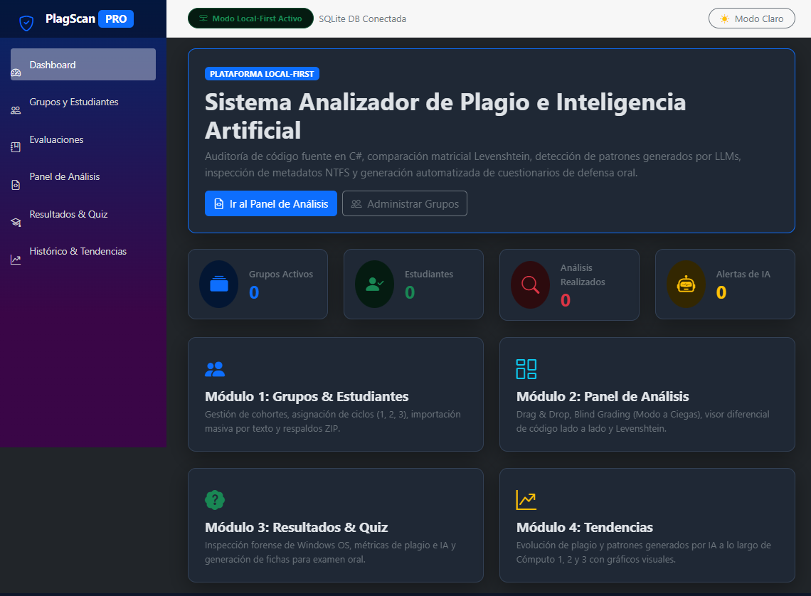

# DOCUMENTO DE TERCER AVANCE DE PROYECTO

Este documento reúne, criterio por criterio, la evidencia de lo implementado en el
tercer avance del **Sistema Analizador de Plagio e Inteligencia Artificial
(PlagScan Pro)**. Cada sección indica qué se pidió, dónde está implementado y cómo
comprobarlo en ejecución.

---

## 1. DASHBOARD (PANTALLA PRINCIPAL, MENÚS) — **1 / 1 pt**

### 1.1 Criterio evaluado

> Definió una pantalla principal con un menú para llamar a los formularios.

### 1.2 Pantalla principal

La aplicación tiene una única pantalla de entrada en la ruta raíz `/`, implementada en
`Components/Pages/Home.razor`. No hay formularios sueltos ni accesos aislados: todas las
pantallas se abren desde esta pantalla principal.

Contenido del Dashboard:

| Bloque | Descripción | Ubicación |
|---|---|---|
| Banner principal | Título del sistema, alcance y accesos directos a Análisis y Grupos | `Home.razor:10-31` |
| Indicadores (KPI) | Grupos activos, estudiantes, análisis realizados y alertas de IA, contados en vivo desde SQLite | `Home.razor:34-90`, `Home.razor:134-141` |
| Accesos rápidos | Cuatro tarjetas clicables, una por módulo del sistema | `Home.razor:93-125` |
| Barra superior | Estado de la base local (`Modo Local-First Activo`, `SQLite DB Conectada`) y cambio de tema | `MainLayout.razor:10-24` |

### 1.3 Menú de navegación

El menú lateral es global: se define una sola vez en `Components/Layout/NavMenu.razor`
y lo inyecta el layout en todas las páginas (`MainLayout.razor:4-7`), por lo que
permanece visible en cualquier pantalla. Cada entrada es un `NavLink` de Blazor que
apunta a una ruta real registrada con `@page`.

| Entrada del menú | Ruta | Página | Archivo |
|---|---|---|---|
| Dashboard | `/` | Inicio | `Home.razor:1` |
| Grupos y Estudiantes | `/grupos` | CRUD de grupos y estudiantes | `Grupos.razor` |
| Evaluaciones | `/evaluaciones` | CRUD de evaluaciones | `Evaluaciones.razor` |
| Panel de Análisis | `/analisis` | Carga y comparación de código | `Analisis.razor` |
| Resultados & Quiz | `/resultados` | Resultados, metadatos y quiz | `Resultados.razor` |
| Histórico & Tendencias | `/historico` | Evolución por ciclo | `Historico.razor` |

Definición de las entradas del menú: `NavMenu.razor:15-48`.
Registro del layout por defecto: `Routes.razor:3`.

Los formularios se abren desde el menú y desde las tarjetas de acceso rápido del
Dashboard, y todas las páginas usan renderizado interactivo
(`@rendermode InteractiveServer`) con acceso a datos vía EF Core.

### 1.4 Evidencia en ejecución



En la captura se observa la pantalla principal (`/`) con el menú lateral completo, los
indicadores calculados desde la base de datos y las cuatro tarjetas de acceso a los
módulos.

### 1.5 Cómo comprobarlo

```powershell
dotnet run --project web_analizador_de_plagios --launch-profile http
```

Abrir `http://localhost:5183`, verificar el Dashboard y navegar por cada entrada del
menú. El proyecto compila sin errores ni advertencias (`dotnet build`).

### 1.6 Estado

**Cumplido.** Existe una pantalla principal única, con menú funcional que llama a todos
los formularios del sistema; las pantallas no se invocan de forma independiente.
